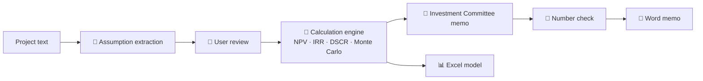

# ☀️ FeasibilityAI

**AI-powered investment feasibility engine for project finance.**
Describe a project in plain text → get assumptions, DCF, IRR, DSCR, scenarios, Monte Carlo risk analysis, an Investment Committee memo and a fully formula-driven Excel model.

> **Design principle: the LLM reads and writes, tested Python does the math.**
> Every number in the output comes from a deterministic, tested calculation engine — and the memo is automatically checked so the AI cannot slip in numbers of its own.

---

## Why

Feasibility studies take days of spreadsheet work, and LLMs are notoriously unreliable with numbers. FeasibilityAI combines both worlds:

| Step | Who does it |
|---|---|
| Read the project description, extract assumptions | 🤖 LLM (Claude) |
| Unit conversions, cash flows, NPV/IRR/DSCR, scenarios, Monte Carlo | 🐍 Tested Python engine |
| Approve or edit every assumption | 👤 Human |
| Write the Investment Committee memo | 🤖 LLM — using only numbers handed to it |
| Verify every number in the memo | 🐍 Automatic number check |

## Architecture



## Features

- **Project returns:** 25-year cash flow, FCFF, project NPV & IRR, payback period
- **Project finance:** annuity loan schedule, CFADS, DSCR (min / average), FCFE, equity IRR
- **Scenarios & sensitivity:** downside / base / upside, two-way sensitivity grids (price × CAPEX)
- **Monte Carlo:** 2,000 simulations — probability of NPV < 0 and of breaching a 1.20x DSCR covenant
- **AI assumption extraction:** every value labelled *Text / Calculated / Default* with the source quote
- **AI Investment Committee memo** with an automatic number check
- **Exports:** formula-driven Excel model (Excel vs. Python reconciliation sheet) and Word memo
- **Validation:** inputs are validated (e.g. a 150% loan ratio is rejected) before entering the model

## Example — 10 MWp solar plant (illustrative assumptions)

| Metric | Downside | Base | Upside |
|---|---|---|---|
| Project NPV (USD) | −26,707 | 1,940,040 | 3,651,014 |
| Project IRR | 10.0% | 13.4% | 16.6% |
| Equity IRR | 11.1% | 19.0% | 26.6% |
| Min DSCR | 1.02 | 1.36 | 1.64 |

Monte Carlo (2,000 runs): **4.5%** probability of negative NPV, **28.4%** probability that min DSCR falls below 1.20.
→ The equity case is robust; **the real risk sits with the lender.**

## Verified against Excel

The exported Excel model rebuilds the whole calculation with native formulas (`NPV`, `IRR`, `PMT`, …).
Its reconciliation sheet compares Excel results with the Python engine — the difference is **0**.
The test suite (`pytest`, 14 tests) checks reference values and financial consistency rules, e.g.
*with no debt, equity IRR must equal project IRR*.

## Quick start

```bash
pip install -r requirements.txt
echo "ANTHROPIC_API_KEY=your-key" > .env      # needed only for the AI features
python -m pytest -v                             # run the tests
python -m streamlit run app/streamlit_app.py    # start the app
```

## Project structure

```
engine/   calculation engine (assumptions, cash flow, debt, scenarios, Monte Carlo)
ai/       LLM layer (client, assumption extraction, memo + number check)
export/   Excel and Word exports
app/      Streamlit interface
tests/    pytest suite
```

## Roadmap

- [ ] More sectors: real estate development, EV charging network
- [ ] PDF upload for investment teasers
- [ ] Due diligence module (red-flag extraction from financial statements and contracts)
- [ ] IFRS module

## Türkçe özet

FeasibilityAI, bir yatırım projesini düz metinle anlatıp NPV, IRR, DSCR, senaryo ve Monte Carlo risk analizi, Yatırım Komitesi Notu ve formülleri çalışan bir Excel modeli üreten açık kaynak bir araçtır. Yapay zeka yalnızca metni okur ve yorum yazar; bütün hesaplar test edilmiş Python kodunda yapılır ve sonuçlar Excel ile birebir doğrulanır.

---

⚠️ *Example assumptions are illustrative. This tool is not investment advice.*

MIT License